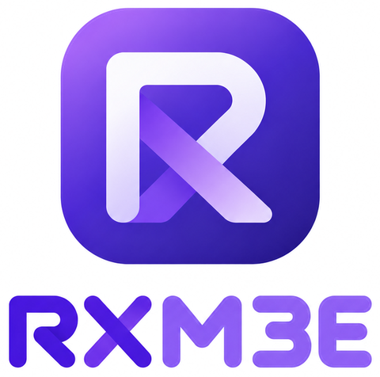

<p align="center">
  
</p>

# RX-Material3E

Material 3 and Material 3 Expressive as framework-free web components. Each component is ported by hand from Google's Jetpack Compose Material3 source, with Material Components for Android as a second reference.

This project is not affiliated with or endorsed by Google.

## Status

Steps 1 to 23 of 79 done. Live demo: https://rxmaterial3e.dpdns.org/ See [ROADMAP.md](ROADMAP.md) for the step-by-step plan and [COMPONENTS.md](COMPONENTS.md) for the full catalog.

| Package          | What it is                                                     | Status                            |
| ---------------- | -------------------------------------------------------------- | --------------------------------- |
| `@rx-m3e/tokens` | All M3 and M3E design tokens as CSS custom properties and JSON | Ready                             |
| `@rx-m3e/web`    | The web components (`rx-*` elements)                           | Package set up, no components yet |

## Tokens

`packages/tokens` is generated from the 119 token objects in Compose Material3. Nothing in it is typed by hand.

```html
<link rel="stylesheet" href="@rx-m3e/tokens/theme.css" />
```

| File                 | Contents                                                                                                               |
| -------------------- | ---------------------------------------------------------------------------------------------------------------------- |
| `css/ref.css`        | Tonal palettes (`--md-ref-palette-*`) and typefaces                                                                    |
| `css/sys.css`        | Typescale (incl. emphasized), shape corners, elevation levels, state opacities, durations, easings, expressive springs |
| `css/typeface.css`   | Language rules: English uses Google Sans Flex, other languages use Noto Sans                                           |
| `css/fonts.css`      | Optional Google Fonts loader for every family above                                                                    |
| `css/color.css`      | Light and dark color roles. Follows the OS; force with `data-theme="light"` or `"dark"` on `<html>`                    |
| `css/components.css` | 2,430 component tokens (`--md-comp-*`) across 104 sets, for reference                                                  |
| `src/tokens.json`    | Everything above as JSON, plus the source commit                                                                       |
| `js/<set>.js`        | One component's tokens for code, e.g. `@rx-m3e/tokens/js/filled-button.js`: each a `var(--md-comp-…, fallback)`        |

CSS has no spring timing function, so each expressive spring (fast, default, slow; spatial and effects) is simulated and exported as a `linear()` easing with a matching duration:

```css
transition: transform var(--md-sys-motion-spring-fast-spatial-duration)
  var(--md-sys-motion-spring-fast-spatial-easing);
```

Run `npm run dev` and open `/demo/tokens.html` to see the colors, typescale, corners, springs and language fonts.

### Fonts

| Text               | Font                                                                                  |
| ------------------ | ------------------------------------------------------------------------------------- |
| English            | Google Sans Flex, falling back to Noto Sans                                           |
| Any other language | The Noto Sans family (Noto Sans, Noto Sans Bengali, Devanagari, Arabic, CJK and more) |

Mark text with its language and the right font follows: `<p lang="bn">`, `<html lang="ar">` and so on. Text without a `lang` uses the English stack, but any script Google Sans Flex can't draw (Bangla, Arabic, Chinese...) still falls through to the matching Noto font. Chinese, Japanese and Korean each get their own Noto family first, so shared characters take the right regional shapes.

The library ships no font files. The easiest way to load them all is the optional `fonts.css`, which pulls every family from Google Fonts; browsers only download the parts a page actually uses.

```html
<link rel="stylesheet" href="@rx-m3e/tokens/fonts.css" />
<link rel="stylesheet" href="@rx-m3e/tokens/theme.css" />
```

To use a different font, override `--md-ref-typeface-brand` and `--md-ref-typeface-plain`.

### Regenerating

```sh
npm run tokens:fetch   # sparse-clones androidx into .cache/
npm run tokens         # rewrites packages/tokens
```

## Typography

Use the class for any of the 15 Material type styles, or its Material 3 Expressive `-emphasized` version:

```html
<link rel="stylesheet" href="@rx-m3e/tokens/typescale.css" />
<h2 class="rx-typescale-headline-small">Settings</h2>
<p class="rx-typescale-body-large-emphasized">Saved</p>
```

Inside your own Lit components, use `typescale('title-medium')` for the declarations or `typescaleStyles` for the classes (both from `@rx-m3e/web`).

## Elevation

```html
<div class="card" style="position: relative">
  <rx-elevation level="2"></rx-elevation>
  ...
</div>
```

`level` is 0 to 5. For component work, set `--rx-elevation` to a token instead, e.g. `var(--md-sys-elevation-level3)`; any value in between works and changes animate. `--rx-elevation-shadow-color` changes the shadow color.

## Focus ring

```html
<button style="position: relative">
  Save
  <rx-focus-ring></rx-focus-ring>
</button>
```

Shows only for keyboard focus (`:focus-visible`), follows the control's corner radius, and springs in. Add `inward` for edge-to-edge rows, or `for="id"` to follow another element.

## Ripple

```html
<button style="position: relative; color: var(--md-sys-color-on-primary)">
  Save
  <rx-ripple></rx-ripple>
  <rx-focus-ring></rx-focus-ring>
</button>
```

Hover tints the control, a press grows a ripple from the pointer (or from the center for the keyboard), using the control's text color. Set `--rx-ripple-color` to change it, `dragged` while dragging, `disabled` to turn it off.

## Icons

```html
<rx-icon>home</rx-icon>
<rx-icon filled label="Favourite">favorite</rx-icon>
<rx-icon><svg viewBox="0 0 24 24">...</svg></rx-icon>
```

Any [Material Symbols](https://fonts.google.com/icons) name, or your own SVG. 24dp and the surrounding text color by default; `variant` picks rounded (default), outlined or sharp; `--rx-icon-size`, `--rx-icon-weight`, `--rx-icon-grade` and `--rx-icon-optical-size` tune it; `flip-rtl` mirrors arrows in right-to-left pages. Without a `label` the icon is hidden from screen readers.

Load the font yourself. To keep it small, ask Google Fonts for just your icons:

```html
<link
  rel="stylesheet"
  href="https://fonts.googleapis.com/css2?family=Material+Symbols+Rounded:opsz,wght,FILL,GRAD@20..48,100..700,0..1,-50..200&icon_names=favorite,home,search&display=block"
/>
```

`@rx-m3e/tokens/icons.css` loads every icon instead (about 5 MB).

## Surface

```html
<rx-surface color="secondary-container" shape="large" elevation="1">...</rx-surface>
<rx-surface interactive color="surface-container-highest" shape="medium">Open</rx-surface>
```

Compose's `Surface`: a `color` role with its matching content color, a `shape` token, `elevation` (shadow, 0 to 5), `tonal-elevation` (tint, 0 to 5) and a border through `--rx-surface-border`. Content is clipped to the shape. `interactive` makes it a button with ripple and focus ring; `selected` and `disabled` work with it.

## Shape engine

A hand port of Google's `androidx.graphics.shapes`, the engine behind the Material 3 Expressive shapes:

```js
import {graphicsShapes as s} from '@rx-m3e/web';

const cookie = s.star(9, {innerRadius: 0.85, rounding: new s.CornerRounding(0.2, 0.2)});
const d = s.toPath(cookie.normalized()); // SVG path data in a 0..1 box
```

`RoundedPolygon` (from a vertex count, vertices or features), `circle`, `rectangle`, `star`, `pill`, `pillStar`, `CornerRounding` (radius and smoothing), bounds, `normalized()`, `transformed()`, `Morph`, and `toPath()`/`morphToPath()` for SVG, clip paths or `Path2D`.

It does Kotlin's 32-bit Float math step for step, so every number matches Android bit for bit. That is what makes morphs pair the same corners as on Android. Google's own tests are ported, and `npm test` checks the output against Google's real Kotlin code exactly (see `scripts/shapes-golden/`).

## Material shapes

```html
<rx-shape shape="cookie-9-sided" style="width: 96px; height: 96px">
  
</rx-shape>
```

All 35 Material 3 Expressive shapes from Compose's `MaterialShapes`: circle, square, slanted, arch, fan, arrow, semi-circle, oval, pill, triangle, diamond, clam-shell, pentagon, gem, sunny, very-sunny, cookie-4/6/7/9/12-sided, ghostish, clover-4/8-leaf, burst, soft-burst, boom, soft-boom, flower, puffy, puffy-diamond, pixel-circle, pixel-triangle, bun and heart. `--rx-shape-color` sets the fill. In code, `MaterialShapes.Heart` or `materialShape('Heart')` gives the polygon and `shapePath(polygon, width, height)` its SVG path. Every shape matches Google's own Kotlin bit for bit.

## Shape morphing

```html
<rx-shape id="s" shape="circle"></rx-shape>
<script>
  s.shape = 'heart'; // morphs, with the expressive default spatial spring
</script>
```

Changing `shape` morphs to the new shape with Google's `Morph`, its progress on the default spatial spring. Sending it back mid-morph springs back from where it is, keeping its speed. `--rx-shape-morph-stiffness` and `--rx-shape-morph-damping` change the spring, `no-morph` switches at once, and reduced motion does too. `morphProgress` reads the progress.

In code:

```js
import {graphicsShapes as s, MaterialShapes, morphShapePath} from '@rx-m3e/web';

const morph = new s.Morph(MaterialShapes.Heart, MaterialShapes.Clover8Leaf);
const d = morphShapePath(morph, 0.5, 200, 200); // halfway, drawn at 200x200
```

All 1,225 pairs of Material shapes, Compose's loading indicator sequence and Google's test pairs are checked against Google's Kotlin.

## Motion

Compose's springs, ported by hand and checked against Google's Kotlin number for number:

```js
import {Animatable, MotionSchemes, animateWithSpring} from '@rx-m3e/web';

const scheme = MotionSchemes.expressive(); // or .standard()

// A value that springs, like Compose's Animatable. Retarget it mid-flight and it keeps its speed.
const x = new Animatable(0);
x.animateTo(240, scheme.defaultSpatial, undefined, () => (ball.style.translate = `${x.value}px`));

// Ordinary keyframes on a spring's curve, timed as Compose would for that distance.
animateWithSpring(card, {translate: ['0 48px', '0 0']}, scheme.fastSpatial, {distance: 48});
```

Each scheme has six springs: `defaultSpatial`, `fastSpatial`, `slowSpatial`, `defaultEffects`, `fastEffects`, `slowEffects`. `motionSpring(element, 'fastSpatial')` reads the one the page's CSS sets.

In CSS, `--md-sys-motion-spring-*-duration` and `-easing` give each spring as a `linear()` curve. Compose ends a spring once it stays within 0.01 of its target in the value's own unit, so a longer move takes longer; the tokens are timed for a 100dp move (spatial) and an alpha from 0 to 1 (effects). `data-motion-scheme="standard"` on any element switches it to the standard scheme.

With reduced motion, animations jump to their end, like Android's "Remove animations". `setMotionDurationScale(5)` slows everything down, `setMotionDurationScale(0)` turns animation off and `null` goes back to following the user's setting.

## Buttons

```html
<rx-button>Save</rx-button>
<rx-button variant="tonal"><rx-icon slot="icon">edit</rx-icon>Edit</rx-button>
<rx-button variant="outlined">Share</rx-button>
<rx-button variant="text">Cancel</rx-button>
```

Compose's five buttons: `filled` (the default), `tonal`, `elevated`, `outlined` and `text`, with ButtonDefaults' colors, elevations, padding and sizes. The container is 40dp tall in a 48dp touch target. `icon` and `trailing-icon` slots take 18dp icons. It works like `<button>` in forms: it submits by default (with its `name` and `value`), `type="reset"` resets and `type="button"` does neither. `disabled` and `<fieldset disabled>` turn it off.

```html
<rx-button size="m"><rx-icon slot="icon">edit</rx-icon>Edit</rx-button>
<rx-button size="xl" shape="square">Start</rx-button>
<rx-button morph>Like</rx-button>
```

`size` is one of the expressive sizes: `xs`, `s`, `m`, `l` or `xl` (32, 40, 56, 96 and 136dp tall). Each one uses ButtonDefaults' padding, icon size, icon spacing and text style for that height, as Compose's size samples do. `shape="square"` gives ButtonDefaults.squareShape, 12dp corners at every size. `morph` is Compose's expressive `shapes` overload: while the button is held, the corners spring to the pressed shape for its size (8dp up to small, 12dp medium, 16dp large and extra large) on the default effects spring, and its padding is the small size's. `--rx-button-shape` and `--rx-button-pressed-shape` set other corners. As in Compose, outlined buttons keep a 1dp border at every size.

## Toggle buttons

```html
<rx-toggle-button>Bold</rx-toggle-button>
<rx-toggle-button variant="tonal" checked
  ><rx-icon slot="icon">star</rx-icon>Starred</rx-toggle-button
>
<rx-toggle-button variant="outlined" size="m" name="alerts">Alerts</rx-toggle-button>
```

Compose's four toggle buttons: `filled` (the default), `tonal`, `elevated` and `outlined`. Off, a toggle button is round; on (`checked`), it takes its checked colors and square corners; held down, its corners pinch in. The corners spring between the three shapes on the fast spatial spring, and the outlined one's outline shrinks and fades when it turns on. `size` is `xs` to `xl` (small by default) and sets the height, padding, icon size, text style and the pressed and checked corners. The `icon` slot takes a leading icon. It is a checkbox for assistive technology and in forms: Space toggles it, it fires `input` and `change`, it submits `value` ("on" by default) under `name` when on, and a form reset puts back its `checked` attribute. `--rx-toggle-button-shape`, `--rx-toggle-button-pressed-shape` and `--rx-toggle-button-checked-shape` set other corners.

## Icon buttons

```html
<rx-icon-button><rx-icon label="Search">search</rx-icon></rx-icon-button>
<rx-icon-button variant="filled"><rx-icon label="Add">add</rx-icon></rx-icon-button>
<rx-icon-button variant="outlined" toggle checked
  ><rx-icon label="Pin">push_pin</rx-icon></rx-icon-button
>
<rx-icon-button toggle morph><rx-icon label="Favourite">favorite</rx-icon></rx-icon-button>
```

Compose's four icon buttons: `standard` (the default), `filled`, `tonal` and `outlined`, 40dp in a 48dp touch target. Standard and outlined icon buttons take the color of the text around them, like Compose's LocalContentColor; `vibrant` gives them fixed colors instead. `toggle` makes it a toggle (`checked`), which is a checkbox for assistive technology and forms; otherwise it is a form button like `rx-button`. `morph` makes the corners pinch in while held and, on a toggle, go squarer when on; as in Compose, a morphing standard or outlined toggle uses the vibrant colors. Give it a name with a `label` on its `rx-icon` or an `aria-label`. `size` is `xs` to `xl` (32 to 136dp tall, small by default) and sets the icon size too; `width` is `narrow`, `uniform` (square, the default) or `wide`; `shape="square"` gives the size's square corners, and with `morph` the pressed and checked corners follow the size. `--rx-icon-button-shape`, `--rx-icon-button-pressed-shape` and `--rx-icon-button-checked-shape` set other corners.

## Button groups

```html
<rx-button-group>
  <rx-button>Day</rx-button>
  <rx-button variant="tonal">Week</rx-button>
  <rx-button variant="tonal">Month</rx-button>
</rx-button-group>
```

Compose's ButtonGroup: buttons, toggle buttons and icon buttons in a row, 12dp apart. A pressed button grows into its neighbours on the fast spatial spring and settles back after you let go; `static` turns that off and `expanded-ratio` (0.15) sets how much. Each item keeps its own width, and icon buttons fill their 48dp touch target, as in Compose. Give items `flex: 1` (Compose's weight) and the group a width to share out the free space. `align` lines up items of different heights (top, center or bottom). The overflow menu Compose shows when the items don't fit comes with menus at step 58; connected groups come in step 24.

## Scrim

```html
<div style="position: relative">
  ...content...
  <rx-scrim open dismissible label="Close sheet"></rx-scrim>
  <div role="dialog">...</div>
</div>
```

Compose's `Scrim`: the `scrim` color at 32% over its positioned container (give it `position: fixed` for the whole window). `open` fades it in and out on the default effects spring. With `dismissible` it is a button labelled by `label` that fires `click`; like Compose's, it is not a Tab stop, so close the modal on Escape too. Set `currentAlpha` to drive it yourself, as a dragged drawer does. `ScrimLabels` has Compose's own labels.

## Building blocks

The shared pieces the components are built from, exported for your own components:

| Piece                             | What it does                                                                                                                                              |
| --------------------------------- | --------------------------------------------------------------------------------------------------------------------------------------------------------- |
| `HostSemanticsController`         | Role, tab stop, `aria-disabled` and ARIA state as attributes on the element itself, so `aria-labelledby` and `<label for>` reach it and checkers see them |
| `addActivation()`                 | Native keyboard behaviour: buttons click on Enter (key down) and Space (key up), toggles on Space; clicks are swallowed while disabled                    |
| `FormAssociated()`                | Form participation through `ElementInternals`: value in FormData, reset, `<fieldset disabled>`, labels, validity                                          |
| `submitForm()`, `resetForm()`     | What a native submit or reset button does, including the submitter's name and value                                                                       |
| `RovingTabindexController`        | One Tab stop for a group; arrow keys (swapped in RTL), Home and End move inside it, skipping disabled items                                               |
| `minimumInteractiveComponentSize` | Compose's 48dp minimum touch target, as host CSS; `--rx-minimum-interactive-component-size: 0` turns it off                                               |
| `redispatchEvent()`, `isRtl()`    | Re-fire an event from inside a shadow root; read the layout direction                                                                                     |
| `PressInteractionController`      | Whether a control is pressed (primary pointer, or Enter or Space held on it), as Compose's `collectIsPressedAsState`                                      |
| `InteractionShapeController`      | Compose's shapeByInteraction: shows one of a set of corner shapes (rest, pressed, checked) and morphs between them                                        |
| `AnimatedShapeState`              | Compose's corner-shape morph: interpolates each corner in px from the current size, with `parseCornerShape()` and `applyCornerShape()` for CSS radii      |

## Theme

Generate a full light and dark scheme from one seed color with Google's color engine:

```js
import {applyTheme} from '@rx-m3e/web';

applyTheme({source: '#0b57d0', variant: 'vibrant', contrast: 0, spec: '2025'});
```

Or theme just part of a page:

```html
<rx-theme source="#146c2e" variant="expressive">...</rx-theme>
```

Styles: `tonal-spot` (default), `neutral`, `vibrant`, `expressive`, `fidelity`, `content`, `rainbow`, `fruit-salad`, `monochrome`. Contrast runs from -1 to 1 (0 standard, 0.5 medium, 1 high). `sourceFromImage(img)` picks a seed from a picture. Light and dark follow `data-theme` on `<html>`, or the OS.

## Development

```sh
npm install
npm run dev           # demo site at http://localhost:5173/demo/
npm run build         # compiles packages/web to dist/ and the demo site to dist-site/
npm run build:site    # only the demo site
npm test              # browser tests (Vitest + Playwright, headless Chromium)
npm run lint          # ESLint with the Lit and web component rules
npm run format        # Prettier
npm run typecheck     # TypeScript, no output
```

The demo site (`demo/`) has a catalog page read straight from COMPONENTS.md, plus a page per finished step. Its top bar switches theme (system, light, dark) and text direction (LTR, RTL). To add a page, copy the `<head>` from `demo/tokens.html` and list the page in `demo/pages.ts`.

### Hosting the demo site

`npm run build` also writes the demo site to `dist-site/` as static files, with every page at the root.

- Cloudflare Workers: build command `npm run build`, deploy command `npx wrangler deploy` (reads `wrangler.jsonc`).
- Vercel: `vercel.json` sets the build command, the `dist-site` output and clean URLs (pages without `.html`).
- Cloudflare Pages or any static host: build command `npm run build`, output directory `dist-site`.

Node 22 comes from `.node-version`.

GitHub Actions runs lint, format check, type check, build and tests on every push and pull request.

Components are Lit elements written in TypeScript. They use Lit's `experimentalDecorators` mode (the same mode `@material/web` uses), because the dev server does not yet compile standard decorators.

## Contributors

- [ashfaqizop](https://github.com/ashfaqizop) (ashfaqizop@gmail.com), the owner
- [siliconcode-dev](https://github.com/siliconcode-dev) (siliconxcode@gmail.com), the owner's second account, which hosts the repository
- [Claude](https://claude.com/claude-code) (Anthropic), who writes the ports with the owner

## License

Apache-2.0. Ported material comes from Apache-2.0 projects; see [NOTICE](NOTICE).
